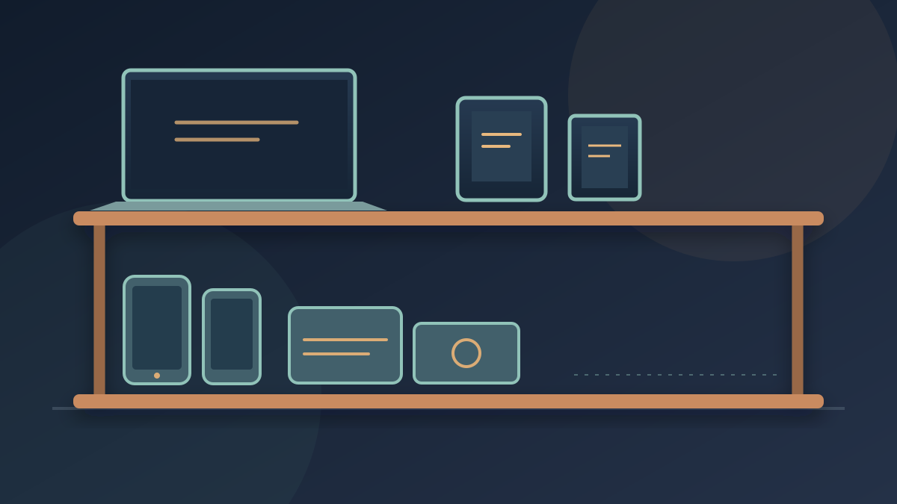

> **Previously on isoul.uk:** [The Music That Still Sounds Like Home](/off-the-stack/the-music-that-still-sounds-like-home/) — the songs and sounds that followed me from childhood into adulthood.

I watched [“I own too much stuff... and you do too (probably)”](https://www.youtube.com/watch?v=fakUwpBjkZw), and spent most of it thinking, *Yes, but my stuff is different.*

A convincing argument, provided I don't look too closely at my stuff.

I have phones I don't use, some with the plastic peeling off. There's a laptop that rarely gets opened and older mechanical hard drives I've kept around. Each item has its own little justification. Together, they take up space while I decide what to do with them.

I like technology. I like getting more life out of it. But keeping something and using it are not the same thing, however often I tell myself it *might* come in handy.

## Giving old things a job

I recently fixed a Pixel 7 Pro so I could start using GrapheneOS. That felt worthwhile: I had a purpose for the phone and repaired what I already owned to make it possible.

JankStation is another example. An old television, speakers and consoles brought together into [a little corner for games and films](/off-the-stack/jankstation-zero-pound-home-cinema/). Individually, some of those things had been sitting around. Together, they have a purpose.

At least, that's the idea. Whether JankStation keeps earning its space depends on whether I actually sit down and enjoy it. Calling a collection of old gear a project doesn't magically make it useful. Though giving it a name does make it harder to dismantle.

That's the distinction I'm trying to get better at: reusing something with intention, rather than finding a more elaborate way to store it.

## How many devices does it take to read one book?

I have a tablet, a Kindle and a phone. All three can display a book.

Do I need all three *to read one*?

There may be good reasons to keep each of them. A Kindle is pleasant for reading; a tablet and phone do other things as well. The question isn't whether their features overlap. It's whether I actually use them in those different ways, or whether I'm keeping options I rarely choose.

The same question applies to the laptop, the spare phones and those hard drives. What job does each one have *now*? If I can't answer that, how long am I willing to let it occupy space while I decide?

## “Just in case” needs a deadline

In the video, the creator talks about wanting new gadgets while older ones sit unused. I recognise that pull. It's much more fun to imagine what a new device could do than to sort through the ones I already have. A purchase offers an instant plan; dealing with an old hard drive means finding out what's on it first. Rude, really.

I'm trying to be more proactive. Fix things I intend to use. Bring old gear together when it makes something I genuinely want to spend time with. Then make a decision about the rest, rather than leaving it in a drawer for some distant version of me who apparently has unlimited time and a very well-organised cable collection.

I don't want to clear a shelf only to fill it with the next interesting gadget, either. That would be a fairly expensive way to dust.

I'm not aiming to own the fewest possible devices. The repaired Pixel has a purpose. JankStation might, as long as I use it. Useful spares can earn their place too. I just want to stop treating *potential* as if it were the same thing as use.

Because eventually, “just in case” needs to meet “am I actually going to use this?”
