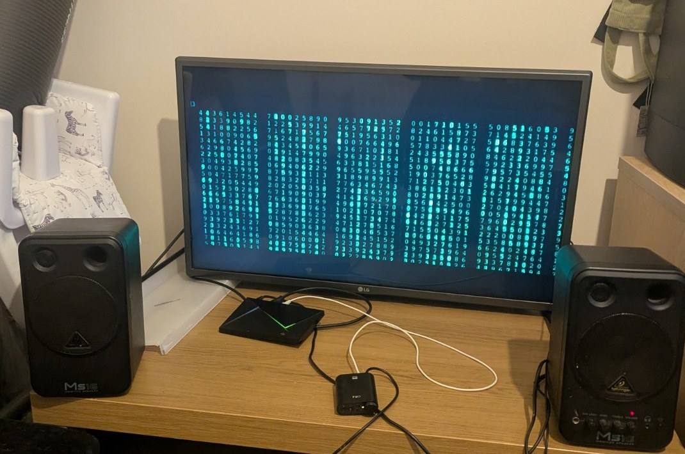
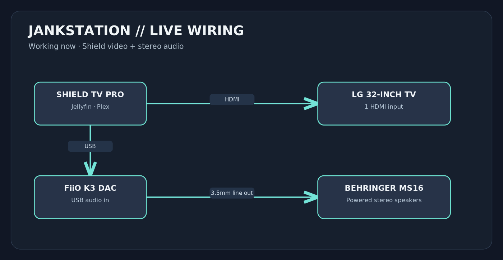
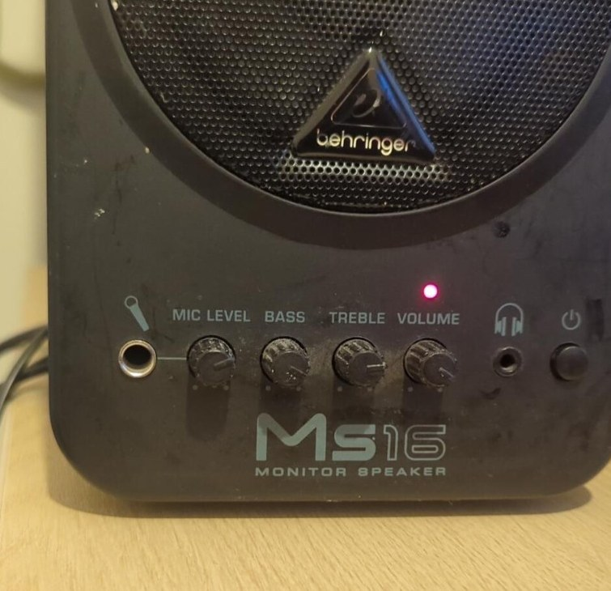
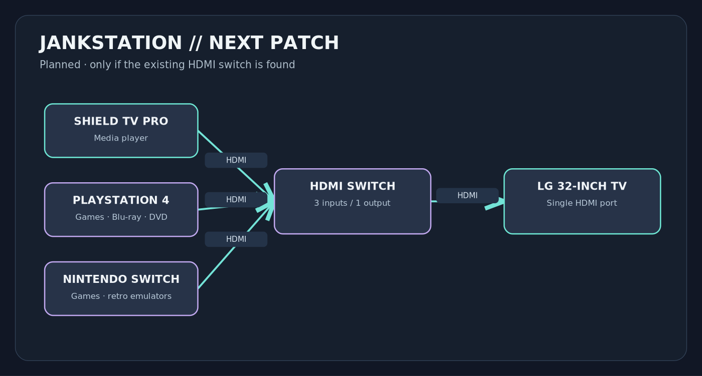
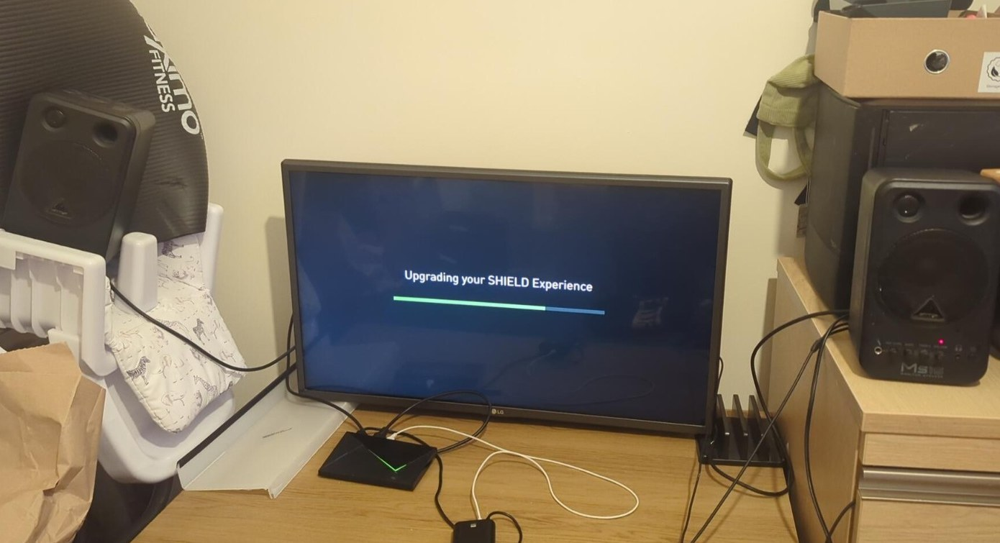
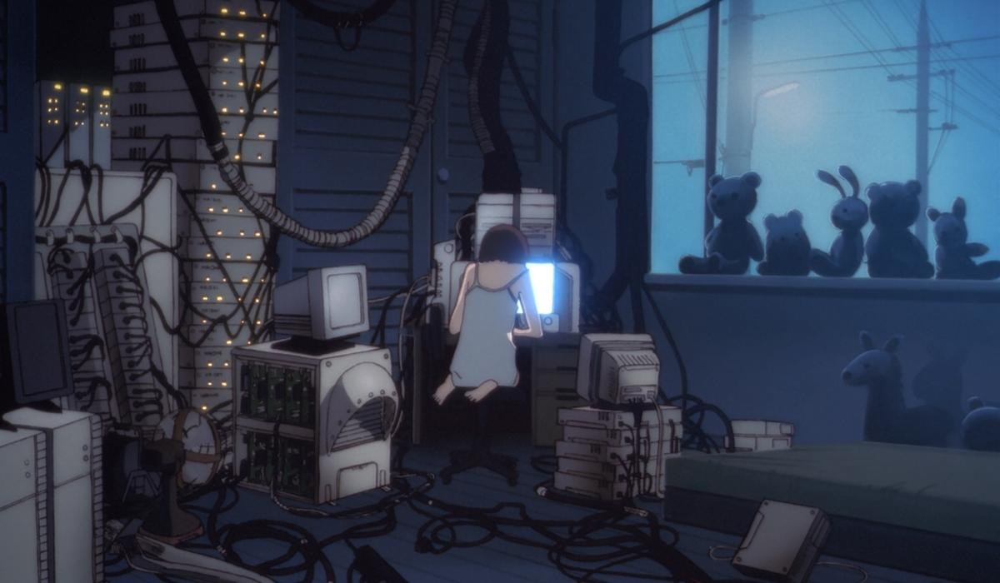

*No budget. No upgrades. Just vibes.*

I've spent enough time chasing new gadgets, tuning my homelab and looking for the next thing to configure. This time, I wanted the opposite: a little corner in my office where I could switch off, put on a film, watch some anime or play an old game.

I didn't want to buy a new TV or sound system. I wanted to see what I could make with things I already owned.

Somehow, that turned into **JankStation**.

*The first arrangement. Nothing fancy, but the components were already here.*

## The inventory: zero new purchases

| Hardware | Job |
| --- | --- |
| Older 32-inch LG TV | Main display |
| Nvidia Shield TV Pro | Jellyfin, Plex and streaming local media |
| FiiO K3 USB DAC | Audio output from the Shield |
| Behringer MS16 powered speakers | Two-channel stereo audio |
| PS4 (Metal Gear Solid edition) | Planned gaming, DVD and standard Blu-ray playback |
| PS2 Slim | Planned original-hardware retro gaming |
| Modded Nintendo Switch | Planned gaming and emulation |
| HDMI switcher, somewhere in storage | Planned way to share the TV's one HDMI input |

The TV was originally given to me when I joined Sky years ago. It had been wall-mounted at my parents' place, and its original stand had disappeared along the way. It's now on two temporary supports while I work with what I have. A proper anti-tip arrangement is still important; makeshift supports are not the same as a secure mount.

It's a modest 32-inch screen, but I'm sitting directly in front of it. For a small office and a single viewer, that's absolutely fine.

## Getting sound without buying a soundbar

The Nvidia Shield TV Pro has HDMI and USB, but no dedicated analogue line-out. I wondered whether my FiiO K3 DAC would work over USB, and it did.

The working audio chain is straightforward:

**Shield Pro → USB → FiiO K3 → rear 3.5 mm line-out → Behringer MS16 speakers.**

HDMI carries the picture from the Shield to the LG. The MS16s are powered speakers, so I don't need another amplifier. I tried moving the speakers further apart to get a wider stereo image; their placement is still a work in progress.

*Current working setup. The PlayStations and Switch are not part of this audio chain yet.*

*The MS16s were already here. The rear line-out on the DAC does the job.*

## A minor side quest: hunting for batteries

I needed **two AAA batteries** for the LG remote and **two CR2032 coin cells** for the Nvidia remote. Rather than order anything, I went digging through drawers.

One CR2032 was still in its packet. The other was tucked away in an unused CCTV remote, with the protective seal still attached. That's the sort of ridiculous little treasure hunt that makes this whole thing fun.

A reminder: spare coin-cell batteries need to be stored securely away from children.

## A growing collection of old machines

The Shield is the everyday heart of JankStation because my films, shows and anime already live in my self-hosted Jellyfin and Plex libraries. I can sit down and actually *watch* something rather than manage another service.

Then there's the PS4. It can handle ordinary Blu-ray discs and DVDs alongside games. I may explore homebrew and PS1/PS2 emulation, but that's a separate project—not something I've installed as part of this build.

My PS2 Slim is still worth keeping for original hardware and physical games, and my modded Nintendo Switch brings another huge library of games into the mix.

The LG only has **one HDMI input**, plus SCART, USB and DC power connections. At the moment, swapping HDMI leads is an option. But I remembered I already own an HDMI switcher somewhere, so the next hunt is to find it and try connecting the **Shield, PS4 and Nintendo Switch**.

*The next step, once I find the HDMI switcher. This is a plan, not a completed connection. The PS4 and Switch will also need an audio solution for the Behringer speakers.*

The PS2 might use SCART with a suitable lead, assuming the port supports input. No reason to pretend the wiring is all sorted yet.

## The speaker-placement experiment

*Experimenting with the soundstage. The left speaker needs a stable, level position before this becomes the regular arrangement.*

Putting speakers farther apart can make a soundtrack feel more spacious, but they also need to be at similar heights and aimed towards the listening position. In other words, not every improvisation is a final improvement.

## Why call it JankStation?

While I was connecting everything, I was reminded of **Serial Experiments Lain**: Lain's room slowly filling with computers, wires and an ever-expanding network.

That chaotic, cobbled-together energy fits this little setup perfectly. It's also a nice reminder of what I enjoy about self-hosting and older technology: ownership, curiosity and making hardware do another job rather than throwing it out.

**JANKSTATION // WIRED BUT WORKING.**

## The point isn't the hardware

This isn't a guide to creating the best home cinema money can buy. It's a reminder that making room to relax doesn't have to involve buying more things.

The TV is old. The speakers are old. The consoles have been around for years. I even scavenged the remote batteries. But I have a place to watch a film, revisit a game, or enjoy an anime episode without sitting at my main workstation.

I spend enough time tinkering with technology. The challenge now is to **stop tinkering long enough to enjoy it**.

JankStation will probably evolve, especially when that missing HDMI switch turns up. For now, it's operational, it has a name, and it cost me nothing extra.

*Present day. Present time.*

---

### Build status (5 November 2026)

- **Working:** LG TV, Shield Pro, USB → FiiO K3 → rear line-out → Behringer MS16.
- **Testing:** speaker positions and getting everything comfortably arranged.
- **Next:** find existing HDMI switcher; try PS4 and Nintendo Switch video input; work out shared audio; connect PS2 if feasible.
- **Spend so far:** £0 on additional equipment.

*Photos are from my actual office. Diagrams are simplified illustrations of the wiring and intended expansion.*
